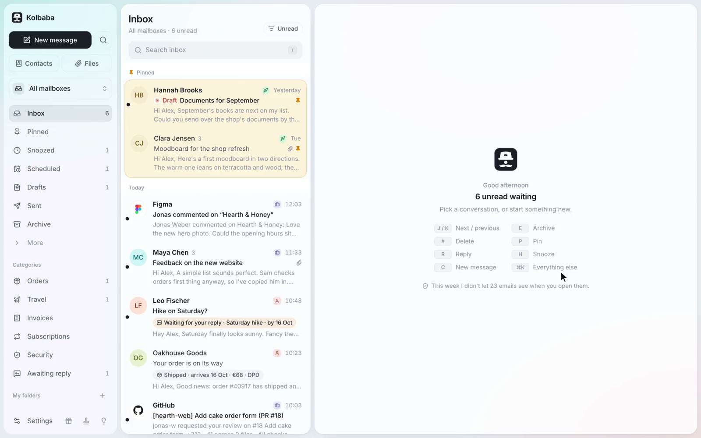

# Kolbaba

**An email app for you and your AI agent.** Kolbaba puts all your mailboxes (Gmail, Outlook and any IMAP
mailbox, including your own domain) in one place. Its built-in MCP server lets Claude, ChatGPT, Cursor or any
other MCP client read, sort, draft and send your mail, with the permissions you set. Every step an agent takes
shows up in the app, with Undo where the step can be undone.



[Website](https://kolbaba.app) · [Open the app](https://app.kolbaba.app) · [Run it on your server](selfhost/README.md) · [Contributing](CONTRIBUTING.md) · [Security](SECURITY.md)

## Three ways to use it

| | What you do | What it costs |
| --- | --- | --- |
| **Hosted** | Open [app.kolbaba.app](https://app.kolbaba.app) and sign in. Nothing to install; add it to your Home Screen or Dock. | The mail client and agents are free. Smart features are part of Kolbaba Plus. |
| **Your own server** | One Docker command on a small VPS or a computer at home. App, database and encryption keys stay with you. [Guide](selfhost/README.md) | Free. Smart features use your own OpenAI key. |
| **Develop locally** | Clone this repository and run `npm run dev`. The app starts on sample mail, no backend needed. [Below](#develop-locally) | Free. |

## What it does

**Mailboxes**

- Gmail and Google Workspace, Outlook and Microsoft 365, and any IMAP mailbox (iCloud, Yahoo, Seznam, your own domain). Server settings are found from the email address.
- All mailboxes in one list, or one at a time. The same mail and state on every device.
- Changes go back to your provider: archive, pins, folders and drafts show up in other mail apps too.

**Calendar**

- A switch next to the name turns the app from mail to calendar: day, week and month, on a phone too.
- Calendars of your mailboxes (Google, Outlook and Microsoft 365, and CalDAV: Seznam, iCloud, Fastmail, your own server), calendars followed by link (.ics), imported .ics files, and calendars kept in Kolbaba itself. Tick which ones you see.
- Events you make or change are saved to the calendar they belong to, repeating ones too. Guests get an invitation by email; a notification reminds you before an event starts.
- Drag an event to another time or day, search events by title, place, notes or guest, answer invitations, and give one event its own reminder time.

**Tasks**

- A to-do list next to mail and calendar: Today, Next 7 days, an Inbox, your own lists and folders, Completed and Trash.
- Add a task in one line ("Call the plumber tomorrow 9:00 !high" sets its day, time and priority), give it a description in the email editor, and make it repeat daily, weekly, on weekdays, monthly or yearly.
- Drag tasks to another day, list or priority, and import a TickTick backup.

**Inbox**

- Archive, snooze, pin, mute, trash, spam, and "My history" to undo your own actions for 30 days.
- "No reply yet" (your emails nobody answered) and a reminder when nobody replies.
- Screener for new senders, one-click unsubscribe, a Subscriptions view, blocking an address or domain.
- Rules, and a suggestion to make one after you move similar mail by hand three times.
- Out-of-office replies for any mailbox, sent by Kolbaba.

**Reading and writing**

- Tracking pixels removed, tracking stripped from links, remote images only after you allow them, a warning about fake sender names.
- Sign-in codes ready to copy, calendar invitations you can answer, private notes on a conversation, all attachments as one zip.
- A block editor with `/` (headings, lists, to-dos, tables), templates, `@` mentions, a check for a forgotten attachment.
- Send later, undo send (6 to 30 seconds), sending without signal, a signature for every mailbox.
- Full-text search with Czech word forms and operators (`from:`, `subject:`, `has:attachment`, `before:`), search at your provider for older mail, `⌘K` for everything, keyboard shortcuts.
- Contacts that fill themselves from your mail, VIP people, and every attachment from every mailbox in one place.

**On every device**

- A web app you install from the browser: iPhone and Android from the Home Screen, Mac with Add to Dock.
- Push notifications per mailbox (all, only people, only VIPs, or none), quiet hours, a badge on the icon.
- Light and dark, 12 colours, a compact or roomy list, English and Czech.
- Sign in with Google, with a code by email, or with a passkey.

**Smart features** (optional, off until you turn them on): smart categories for orders, travel, invoices,
subscriptions and security notices, "Awaiting my reply", and conversation summaries. They send mail to an AI
provider, and the app explains what goes where next to each switch.

## For AI agents

Kolbaba is an MCP server at `https://<your Kolbaba>/api/mcp` (OAuth sign-in, Streamable HTTP). When you
connect an agent, you choose which mailboxes it sees and one of three access levels:

| Access level | Tools |
| --- | --- |
| **Read only** | `list_mailboxes`, `search`, `list_threads`, `read_thread`, `list_folders`, `get_attachment` |
| **Organize & draft** | the above, plus `create_draft`, `update_draft`, `delete_draft`, `archive`, `move_to_inbox`, `mark_read`, `mark_unread`, `pin`, `unpin`, `trash`, `move_to_folder`, `snooze`, `remind_if_no_reply`, `set_note`, `screen_sender` |
| **Full access** | the above, plus `send` and `unsubscribe` |

- The calendar and the tasks are shared with an agent apart from the mailboxes. With them, it also gets `list_calendars`, `list_events`, `create_event`, `update_event`, `delete_event` (inviting guests needs Full access) and `list_task_lists`, `list_tasks`, `create_task`, `update_task`, `delete_task`; Read only lets it look, not change.
- Every call shows up under AI activity in the app, with Undo where the step can be undone. You can pause or remove an agent at any time.
- Agents get email content marked as untrusted third-party text, not instructions.
- Sending waits at least 30 seconds, so you can stop it, and agents are limited to 20 emails and 100 recipients an hour.

The tools are defined in [`src/server/mcp/tools.ts`](src/server/mcp/tools.ts), [`calendar-tools.ts`](src/server/mcp/calendar-tools.ts) and [`task-tools.ts`](src/server/mcp/task-tools.ts).

## How it works

```
 phone / browser ──────► Next.js web app ─────────────► Postgres
 (installable web app)   UI, API, sign-in,              (Drizzle ORM)
        ▲                MCP server at /api/mcp             ▲
        │ Web Push              │ nudge                     │
        │                       ▼                           │
        └──────────────── sync worker ──────────────────────┘
                          always on: IMAP IDLE, Gmail push,
                          scheduled sending, snooze, reminders
                                │
                 Gmail API · Microsoft · any IMAP/SMTP server
```

- **Web app** ([`src/app`](src/app), [`src/server`](src/server)): Next.js 16 with the App Router. The interface, the API, sign-in and the MCP server.
- **Sync worker** ([`worker/`](worker)): one small process that is always running. It holds an IMAP IDLE connection per mailbox, keeps Gmail push registered, sends scheduled mail, wakes snoozed conversations and sends Web Push notifications. Without it the app still works, but new mail only arrives when the app is open.
- **Database**: Postgres, with the schema and migrations in [`drizzle/`](drizzle).
- **Security**: mailbox passwords and tokens are envelope-encrypted (AES-256-GCM, a key per record, wrapped by `CREDENTIALS_KEK`). Sessions and OAuth tokens are stored only as hashes. Incoming HTML is sanitized on the server and shown in a sandboxed iframe without scripts, and remote images are blocked until you allow them.

The hosted version runs the web app on Vercel, the worker on Fly.io and Postgres on Neon, all in Frankfurt.
The self-hosted image puts the web app and the worker in one container next to Postgres and Caddy.

## Develop locally

You need Node.js 22 or newer.

```bash
git clone https://github.com/jakubSt28/kolbaba.git
cd kolbaba
npm install
npm run dev
```

Open http://localhost:3000. Without any configuration the app runs as a clickable prototype on sample mail
(`NEXT_PUBLIC_DATA_MODE=mock`), which is enough for most interface work. To connect real mailboxes you need
Postgres and a few keys: [CONTRIBUTING.md](CONTRIBUTING.md) has the full setup, tests and conventions.

## Repository layout

| Folder | What's in it |
| --- | --- |
| [`src/app`](src/app) | Next.js pages and API routes, including the MCP endpoint (`api/mcp`) |
| [`src/components`](src/components) | The interface |
| [`src/lib`](src/lib) | Code shared by the interface and the server: store, translations, release notes, sample data |
| [`src/server`](src/server) | Sync (Gmail API, Microsoft, IMAP/SMTP), the calendar (Google, Microsoft Graph, CalDAV, .ics), auth, encryption, MCP tools, smart features, billing |
| [`worker/`](worker) | The always-on sync worker |
| [`drizzle/`](drizzle) | Database migrations |
| [`selfhost/`](selfhost) | Docker Compose setup and installer for your own server |
| [`test/`](test) | Test setup and helpers (tests live next to the code as `*.test.ts`) |

## Need help running it?

The [self-hosting guide](selfhost/README.md) covers installing, updates, backups and the optional Google and
Microsoft apps. If you'd rather have someone set it up for you, on your server or your company's, that's a paid
service: write to [hello@kolbaba.app](mailto:hello@kolbaba.app) or use the form on
[kolbaba.app/self-hosted](https://kolbaba.app/self-hosted).

## Contributing

Bug reports, ideas and pull requests are welcome. Read [CONTRIBUTING.md](CONTRIBUTING.md) first: it explains the
setup, the conventions, and how an accepted pull request lands in this repository. Please report security issues
privately, as described in [SECURITY.md](SECURITY.md).

## License

Kolbaba is free software under the [GNU Affero General Public License v3.0 or later](LICENSE). You can use,
study, change and share it. If you run a changed version for other people over a network, you have to offer them
the source code of your version under the same license.

The name Kolbaba and its logo are not covered by the license: see [TRADEMARKS.md](TRADEMARKS.md). A fork you
offer to others needs its own name and logo.

Copyright © 2026 Jakub Šťastný. Kolbaba is made in Prague. The name comes from the postman in Karel Čapek's
*Postman's Tale*; Čapek also gave the world the word "robot".
